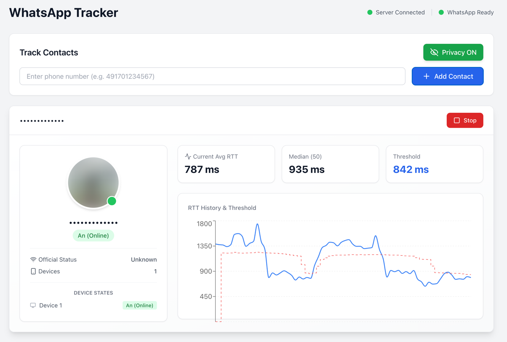

<h1 align="center">Device Activity Tracker</h1>
<p align="center">WhatsApp & Signal Activity Tracker via RTT Analysis</p>

<p align="center">
  
  
  
  
</p>

> ⚠️ **DISCLAIMER**: Proof-of-concept for educational and security research purposes only. Demonstrates privacy vulnerabilities in WhatsApp and Signal.

## Overview

This project implements the research from the paper **"Careless Whisper: Exploiting Silent Delivery Receipts to Monitor Users on Mobile Instant Messengers"** by Gabriel K. Gegenhuber, Maximilian Günther, Markus Maier, Aljosha Judmayer, Florian Holzbauer, Philipp É. Frenzel, and Johanna Ullrich (University of Vienna & SBA Research).

**What it does:** By measuring Round-Trip Time (RTT) of message delivery receipts, this tool can detect:
- When a user is actively using their device (low RTT)
- When the device is in standby/idle mode (higher RTT)
- Potential location changes (mobile data vs. WiFi)
- Activity patterns over time

**Supported Platforms:**
- **WhatsApp**: Full support (CLI + Web interface)
- **Signal**: Web interface only (requires Signal API)

**Security implications:** This demonstrates a significant privacy vulnerability in messaging apps that can be exploited for surveillance.

## Example



The web interface shows real-time RTT measurements, device state detection, and activity patterns.

## Installation

```bash
# Clone repository
git clone https://github.com/guberm/device-activity-tracker.git
cd device-activity-tracker

# Install dependencies
npm install
cd client && npm install && cd ..
```

**Requirements:** 
- Node.js 20+
- npm or yarn
- WhatsApp account (for WhatsApp tracking)
- Docker (optional, for containerized deployment)

## Usage

### Docker (Recommended)

The easiest way to run the application:

```bash
# Copy environment template
cp .env.example .env

# Build and start all services (backend, frontend, Signal API)
docker compose up --build
```

Access the application at:
- **Frontend:** [http://localhost:3000](http://localhost:3000)
- **Backend API:** [http://localhost:3001](http://localhost:3001)
- **Signal API:** [http://localhost:8080](http://localhost:8080)

To customize ports, edit `.env`:
```bash
BACKEND_PORT=3001
CLIENT_PORT=3000
```

Stop services:
```bash
docker compose down
```

### Manual Setup

#### 1. Environment Configuration (Optional)

```bash
cp .env.example .env
# Edit .env to customize ports and API URLs
```

#### 2. Web Interface (WhatsApp + Signal)

Terminal 1 - Start backend:
```bash
npm run dev
```

Terminal 2 - Start frontend:
```bash
npm run start:client
```

Open [http://localhost:3000](http://localhost:3000):
1. Scan QR code with WhatsApp
2. Select a contact or enter phone number to start tracking

#### 3. CLI Interface (WhatsApp only)

Simple mode:
```bash
npm start
```

With parameters:
```bash
npx tsx src/index.ts --phone +1XXXXXXXXXX --service whatsapp
```

**CLI Flags:**
- `--phone <number>` - Target phone number (with country code)
- `--service <service>` - Service: `whatsapp` (default)
- `--debug` or `-d` - Enable debug output

**Example:**
```bash
npx tsx src/index.ts --phone +491701234567 --debug
```

### Output Explanation

```
╔════════════════════════════════════════════════════════════════╗
║ 🟡 Device Status Update - 09:41:51                             ║
╠════════════════════════════════════════════════════════════════╣
║ JID:        ***********@lid                                    ║
║ Status:     Standby                                            ║
║ RTT:        1104ms                                             ║
║ Avg (3):    1161ms                                             ║
║ Median:     1195ms                                             ║
║ Threshold:  1075ms                                             ║
╚════════════════════════════════════════════════════════════════╝
```

- **🟢 Online**: Device actively in use (RTT below threshold)
- **🟡 Standby**: Device idle/locked (RTT above threshold)
- **🔴 Offline**: Device unreachable (no delivery confirmation)

## How It Works

### Probe Methods

The tracker sends probe messages and measures RTT to detect device state:

| Method | Platform | Description |
|--------|----------|-------------|
| **Delete** | WhatsApp | Sends silent delete request (default) |
| **Reaction** | WhatsApp | Sends emoji reaction to non-existent message |
| **Reaction** | Signal | Sends emoji reaction to non-existent message |
| **Message** | Signal | Sends disappearing message |

### Detection Logic

1. **Measurement**: RTT is calculated from probe send time to delivery confirmation (CLIENT ACK)
2. **Threshold**: Dynamic threshold = 90% of median RTT
3. **State Detection**:
   - RTT < Threshold → Online (actively using device)
   - RTT ≥ Threshold → Standby (device idle)
4. **Adaptation**: Median RTT continuously updated to adapt to network conditions

### Switching Probe Methods

In web interface: Use dropdown in control panel  
In CLI: Delete method used by default

## Architecture

### Backend
- **Express + Socket.IO** for real-time communication
- **Baileys** for WhatsApp connection via WebSocket
- **Signal CLI REST API** for Signal tracking
- **TypeScript** for type safety

### Frontend
- **React 18** with Hooks
- **Tailwind CSS** for styling
- **WebSocket** for real-time RTT updates
- Components: Login, Dashboard, ContactCard

### Data Flow
```
WhatsApp/Signal → Backend (RTT Analysis) → WebSocket → Frontend (Real-time Display)
```

## Troubleshooting

### WhatsApp Issues
- **QR code not scanning**: Delete `auth_info_baileys/` and restart
- **"Not registered on WhatsApp"**: Number doesn't have WhatsApp account
- **Connection drops**: Network issue or device went offline

### Signal Issues
- **Signal API not starting**: Ensure Docker is running (`docker ps`)
- **"Connection refused" on 8080**: Port already in use, change in `.env`
- **No delivery receipts**: Signal device offline or not connected

### General Issues
- **Port already in use**: Change `BACKEND_PORT` or `CLIENT_PORT` in `.env`
- **Module not found**: Run `npm install` and `cd client && npm install`
- **TypeScript errors**: Run `npm run build` to compile

## Project Structure

```
device-activity-tracker/
├── src/
│   ├── index.ts              # CLI interface
│   ├── server.ts             # Express + Socket.IO server
│   ├── tracker.ts            # WhatsApp RTT analysis logic
│   ├── signal-tracker.ts     # Signal RTT analysis logic
│   └── scripts/
│       └── init-signal.ts    # Signal API initialization
├── client/
│   ├── src/
│   │   ├── components/
│   │   │   ├── Login.tsx     # WhatsApp QR code login
│   │   │   ├── Dashboard.tsx # Real-time tracking display
│   │   │   └── ContactCard.tsx
│   │   ├── App.tsx           # Main component
│   │   └── index.tsx         # React entry point
│   ├── public/               # Static files
│   └── package.json
├── Dockerfile                # Backend container
├── docker-compose.yml        # Multi-container orchestration
├── .env.example              # Configuration template
├── tsconfig.json             # TypeScript config
├── package.json              # Dependencies
└── README.md
```

## npm Scripts

| Script | Description |
|--------|-------------|
| `npm start` | Run CLI interface |
| `npm run dev` | Start backend server + init Signal API |
| `npm run start:server` | Start backend only (includes Signal API) |
| `npm run start:client` | Start React frontend |
| `npm run start:signal-api` | Initialize Signal API |
| `npm run build` | Compile TypeScript to JavaScript |

## npm Scripts

| Script | Description |
|--------|-------------|
| `npm start` | Run CLI interface |
| `npm run dev` | Start backend server + init Signal API |
| `npm run start:server` | Start backend only (includes Signal API) |
| `npm run start:client` | Start React frontend |
| `npm run start:signal-api` | Initialize Signal API |
| `npm run build` | Compile TypeScript to JavaScript |

## How to Protect Yourself

1. **Enable "Block unknown account messages"** in WhatsApp:
   - Settings → Privacy → Advanced → Block unknown account messages
   - Reduces but doesn't eliminate probe message spam

2. **For Signal**: Enable privacy settings:
   - Settings → Privacy → Block Unknown Contacts

3. **General measures**:
   - Disabling read receipts helps with regular messages but NOT this attack
   - Consider using disappearing messages
   - Keep apps updated

**Note:** As of January 2026, this vulnerability remains exploitable in both WhatsApp and Signal.

## Ethical & Legal Considerations

⚠️ **For research and educational purposes only.**

- Never track people without explicit written consent
- May violate privacy laws in your jurisdiction
- Authentication credentials (`auth_info_baileys/`) must never be committed
- Use only for authorized security research
- Respect user privacy and legal requirements

## Citation

Based on research by Gegenhuber et al., University of Vienna & SBA Research:

```bibtex
@inproceedings{gegenhuber2024careless,
  title={Careless Whisper: Exploiting Silent Delivery Receipts to Monitor Users on Mobile Instant Messengers},
  author={Gegenhuber, Gabriel K. and G{\"u}nther, Maximilian and Maier, Markus and Judmayer, Aljosha and Holzbauer, Florian and Frenzel, Philipp {\'E}. and Ullrich, Johanna},
  year={2024},
  organization={University of Vienna, SBA Research}
}
```

## License

MIT License - See [LICENSE](LICENSE) file

Built with:
- [@whiskeysockets/baileys](https://github.com/WhiskeySockets/Baileys) - WhatsApp Web API
- [signal-cli-rest-api](https://github.com/bbernhard/signal-cli-rest-api) - Signal CLI wrapper
- [Express.js](https://expressjs.com/) - Backend framework
- [Socket.IO](https://socket.io/) - Real-time communication
- [React](https://react.dev/) - Frontend framework
- [Tailwind CSS](https://tailwindcss.com/) - Styling

---

**Use responsibly. This tool demonstrates real security vulnerabilities that affect millions of users.**

